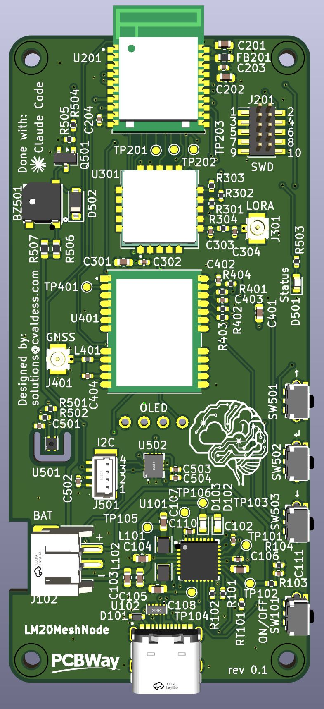
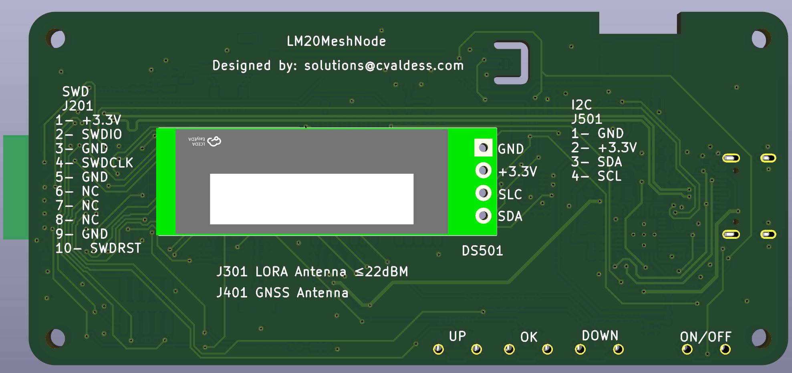
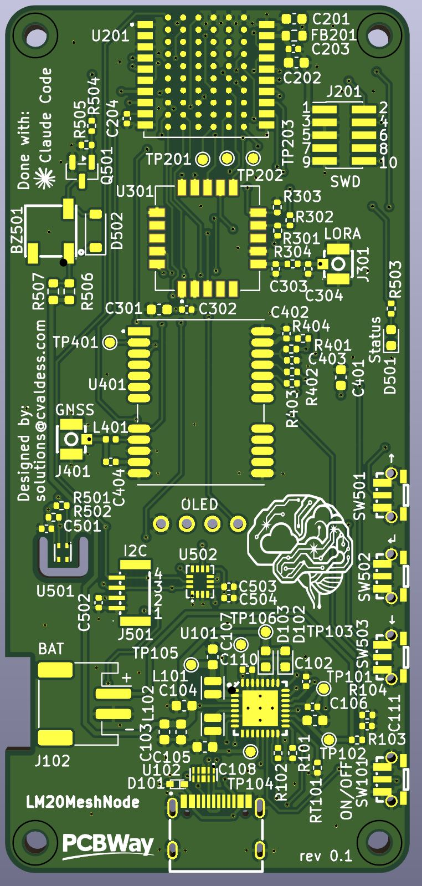

# LM20MeshNode

Pocket [Meshtastic](https://meshtastic.org/) node built around the Nordic **nRF54LM20A**
(Minew ME54BS13 module), with an Ebyte **E22-900MM22S** (SX1262) LoRa module, an Ebyte
**E108-GN04S** GNSS receiver and a Nordic **nPM1300** PMIC for a single-cell LiPo battery.
It connects to the phone over Bluetooth LE.

| Front | Back |
|-------|------|
|  |  |

> **Status:** revision 0.1, not yet manufactured or tested. There is no Meshtastic firmware
> variant for this board yet.

## Features

- **MCU:** Minew ME54BS13 (nRF54LM20A, Bluetooth LE with integrated antenna), USB-C to the
  nRF54LM20A USB port, 2×5 1.27 mm Cortex Debug (SWD) header (J201) and debug UART pads.
- **LoRa:** Ebyte E22-900MM22S (SX1262, up to 22 dBm) with U.FL antenna connector (J301).
  TXEN is driven by DIO2 on the board; RXEN comes from the MCU.
- **GNSS:** Ebyte E108-GN04S with U.FL antenna connector (J401). Fit L401 (82 nH) to power an
  active antenna. The GNSS supply (nPM1300 BUCK1) is off at power-up and is switched by
  firmware; the backup supply (V_BCKP) stays on from 3.3 V.
- **Power:** nPM1300 PMIC with USB-C input and ESD protection, 1S LiPo charger (JST PH 2.0,
  J102), on-board 10 kΩ NTC, 3.3 V main rail (BUCK2), power button (SW101) on SHPHLD, charge
  and error LEDs, and a battery voltage divider to an ADC input.
- **User interface:** 0.91" 128×32 OLED (SSD1306) on the back, three side buttons (UP, OK,
  DOWN), magnetic buzzer and a status LED.
- **Sensors:** Nyfea SHT41-P-NF temperature/humidity sensor (SHT41 compatible), thermally
  isolated by a slot, and an ST LSM6DS3TR-C IMU wired for wake-on-motion (INT1 on P0.02).
- **Expansion:** 4-pin 1 mm I²C connector (J501, Qwiic-style pinout: GND, 3.3 V, SDA, SCL).
- **Board:** 4 layers (signal / GND / 3.3 V / signal), 40 × 85.68 mm, 1.6 mm, M2 mounting
  holes. All SMD parts are on the top side.

## nRF54LM20A pin map

| Function | Pin | Notes |
|----------|-----|-------|
| LoRa SPI (SPIM22): SCK, MOSI, MISO, NSS | P1.17, P1.16, P1.15, P1.18 | |
| LoRa BUSY, DIO1, NRST | P1.19, P1.23, P1.26 | |
| LoRa RXEN | P1.13 | TXEN from DIO2; optional MCU TXEN on P1.12 (R302, not fitted) |
| I²C (TWIM30): SDA, SCL | P0.03, P0.04 | 4.7 kΩ pull-ups |
| GNSS UART (UARTE20): MCU TX → GNSS RXD, GNSS TXD → MCU RX | P1.03, P1.29 | 1 kΩ series resistors |
| GNSS PPS, reset | P1.04, P1.00 | |
| GNSS power enable | P1.05 | To nPM1300 GPIO0 |
| PMIC interrupt | P1.06 | From nPM1300 GPIO1 |
| Battery voltage (divider 2 × 1 MΩ) | P1.30 (AIN2) | |
| Buttons UP, OK, DOWN | P1.27, P1.28, P1.25 | |
| Buzzer (PWM) | P1.09 | |
| Status LED | P2.00 | |
| IMU INT1, INT2 | P0.02, P0.05 | P0 can wake the chip from System OFF |
| Debug UART (UARTE00): TX, RX | P2.02, P2.07 | Test pads |

I²C devices: nPM1300 `0x6B`, LSM6DS3TR-C `0x6A`, SHT41 `0x44`, OLED `0x3C`.

### Firmware notes

- The nPM1300 starts with the **battery charger disabled**. Firmware must enable charging
  over I²C. The board is designed so that LoRa and Bluetooth work without a PMIC driver.
- The E22-900MM22S used here has a crystal, not a TCXO: do not define a DIO3 TCXO voltage.
- The GNSS rail (BUCK1) must be set to 3.3 V and enabled by firmware.

## Manufacturing

The [`fab/pcbway/`](fab/pcbway/) folder contains:

- `nrflm20-meshnode_rev0.1_pcbway.zip`: Gerber files (4 copper layers, masks, top paste,
  silkscreen, outline), Excellon drill files (PTH and NPTH) and an IPC-D-356 netlist.
- `gerber/`: the same files unzipped, plus drill maps and the drill report.
- `pedido_pcbway.txt`: order settings and pre-production checks (in Spanish).

Board: 4 layers, 1.6 mm, 1 oz copper, ENIG recommended, minimum track/space 0.2 mm, minimum
drill 0.3 mm. Stencil: top side only, 0.10 mm. The standard PCBWay 4-layer stackup is fine;
impedance control is not needed.

## Design files

- [KiCad 10](https://www.kicad.org/) project: `nrflm20-meshnode.kicad_pro`. The root schematic
  has five sheets: power, MCU, LoRa, GNSS and interface.
- `libs/`: project symbols, footprints and 3D models. The ME54BS13 and E108-GN04S 3D models
  were drawn from their datasheets (generators in `docs/gen/`).
- `docs/`: block diagram and schematic drafts (SVG). `docs/gen/` has the Python scripts used
  during the design.
- `lista_compra.txt`: shopping list (in Spanish).

Some footprints and 3D models come from [easyeda2kicad](https://github.com/uPesy/easyeda2kicad.py)
(`${EASYEDA2KICAD}`). The footprints are stored in the board file, but their 3D models are
not included in this repository.

## Credits

- **Designed by:** solutions@cvaldess.com
- **Made with:** [Claude Code](https://claude.com/claude-code), [KiCad](https://www.kicad.org/)
  and [Konnect-EDA](https://github.com/Orchis-ai-LLC/Konnect-EDA)
- **Sponsor:** [PCBWay](https://www.pcbway.com/)
